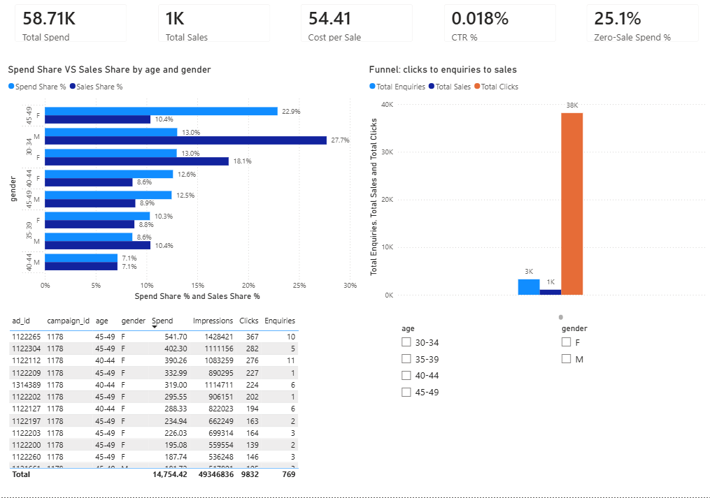

# Ad Spend Leakage Audit

Which audience segments take a big share of ad budget but produce few sales? This project audits 1,143 ads, builds SQL and Power BI reports, and tests a safe budget shift.

## Business question

Where is the ad budget leaking, and how much could a small reallocation improve sales without increasing the total budget?

## Dataset

Kaggle "Sales Conversion Optimization": 1,143 ads from 3 campaigns (916, 936, 1178). I used `Approved_Conversion` as sales. The data has no revenue column, so I measure efficiency with cost per sale instead of ROAS.

## Tools

Python (Pandas), SQL (SQLite, written to also work in MySQL 8), Power BI, Excel.

## What I did

| Step | What | File |
|---|---|---|
| 1 | Explored and cleaned the data | `01_explore_and_clean.py` |
| 2 | Calculated CTR, CPC, CPM, cost per enquiry, cost per sale | `02_calculate_metrics.py` |
| 3 | Analysed segments with SQL (CTEs, window functions) | `03_sql_analysis.py`, `sql/` |
| 4 | Built the Power BI dashboard with DAX measures | `powerbi/` |
| 5 | Modelled a what-if budget shift | `04_what_if_budget.py` |

## Key findings

- Total spend 58,705.23 produced 1,079 approved sales, so the average cost per sale is 54.41.
- Four segments (women 45-49, 40-44, 35-39 and men 45-49) take 58.3% of spend but give only 36.7% of sales.
- Women 45-49 alone take 22.9% of spend for 10.4% of sales. Their cost per sale is 119.94, about 2.2 times the average.
- Men 30-34 are the most efficient, at 25.55 per sale.
- 559 ads got no approved sales but consumed 25.1% of spend (14,754.42).
- Funnel: 38,165 clicks, then 3,264 enquiries, then 1,079 sales.

## Recommendation

Test moving 10% of the weak segments' budget (about 3,421, or 5.8% of spend) to the efficient segments. The model estimates +28.5 sales in the cautious case and +62.5 in the optimistic case. Test it first, because these are projections.

Full write-up: [docs/insights.md](docs/insights.md)

## Limits

- No revenue data, so no ROAS.
- The results show association, not causation.
- Campaign 1178 is 94.8% of spend, so the findings mostly reflect it.
- The what-if model assumes the extra budget performs like past spend, or 50% worse in the cautious case.

## How to run
Put `KAG_conversion_data.csv` in `data/raw/` first (download it from Kaggle).

Then run these commands in order:

    pip install pandas
    py -3.12 01_explore_and_clean.py
    py -3.12 02_calculate_metrics.py
    py -3.12 03_sql_analysis.py
    py -3.12 04_what_if_budget.py
